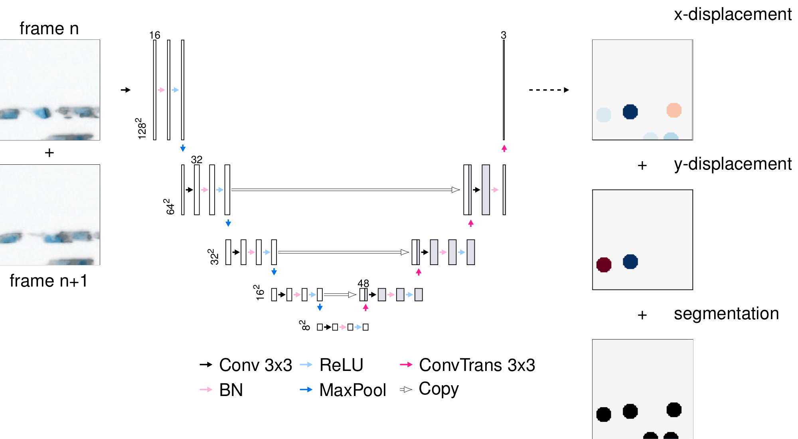

# cnn-cell-displacement-prediction
Contains the code for training a CNN to segment and predict the displacement of cells on the x- and y-axis, based on images from two consecutive time points, derived from microscopy movies.

<p align="center">
  
  <br>
  <b>Figure 1:</b> U-Net architecture, input and output. The neural network takes as an input two stacked consecutive image tiles (128x128x3) and outputs a segmentation mask, as well as displacement masks for the x-axis and y-axis displacement.
</p>

## Citation

If you use this code in your research, please cite:

> Mihaela Mihaylova, Ankur Ankan, Shabaz Sultan, Inge MN Wortel, Jérémy Postat, Maryl Harris, Mauricio Merino, Judith N Mandl, Johannes Textor.
> **A human-in-the-loop approach for faster cell tracking.**
> *bioRxiv* 2026.10.06.756962; doi: [10.64898/2026.10.06.756962](https://doi.org/10.64898/2026.10.06.756962)

```bibtex
@article{mihaylova2026humanintheloop,
  title   = {A human-in-the-loop approach for faster cell tracking},
  author  = {Mihaylova, Mihaela and Ankan, Ankur and Sultan, Shabaz and Wortel, Inge M. N. and Postat, J{\'e}r{\'e}my and Harris, Maryl and Merino, Mauricio and Mandl, Judith N. and Textor, Johannes},
  journal = {bioRxiv},
  year    = {2026},
  doi     = {10.64898/2026.10.06.756962},
  note    = {Preprint 2026.10.06.756962}
}
```